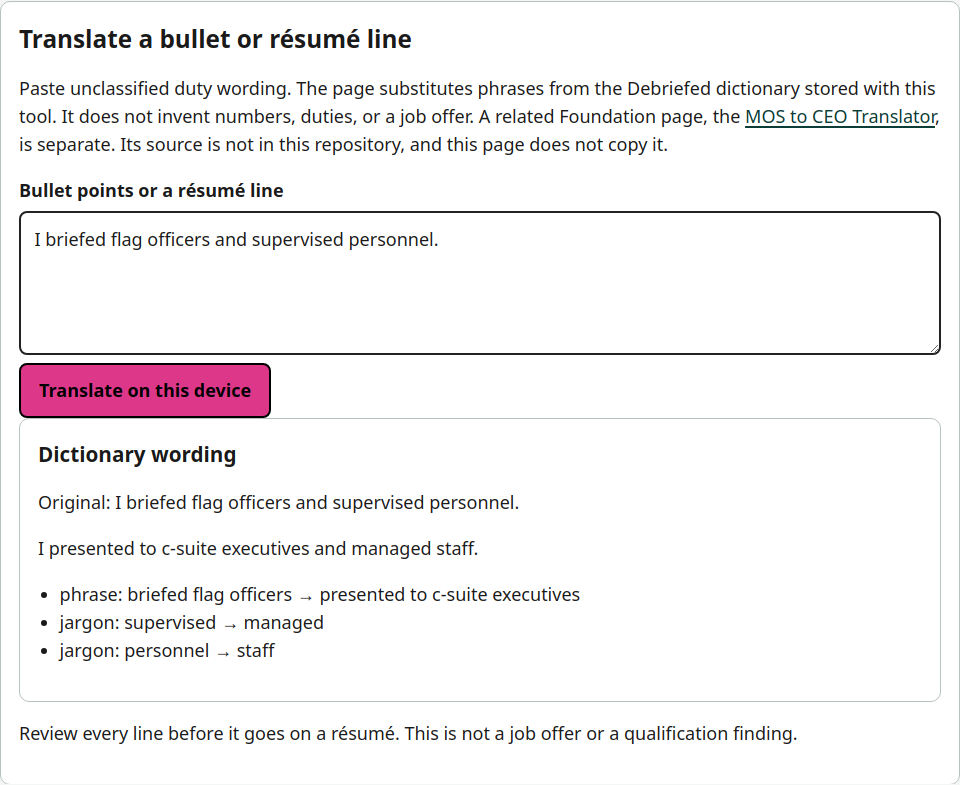
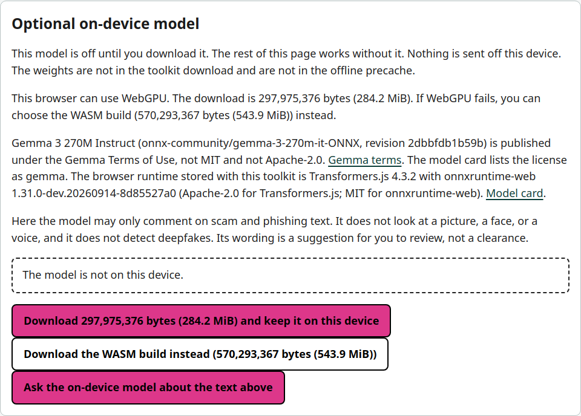
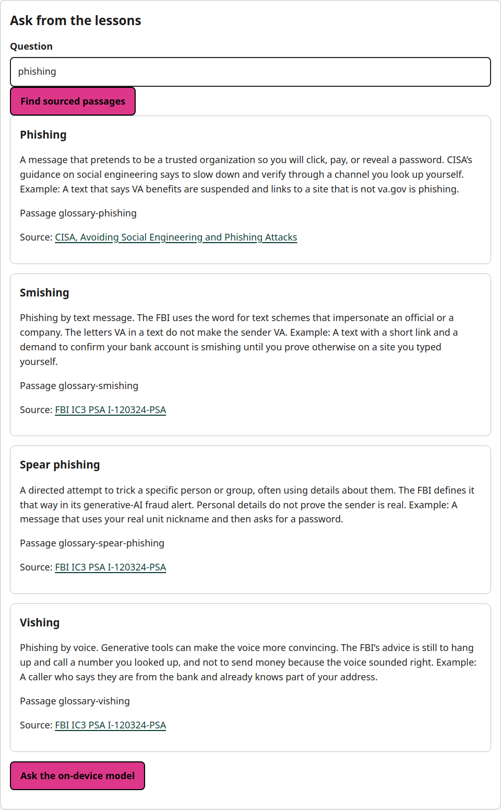
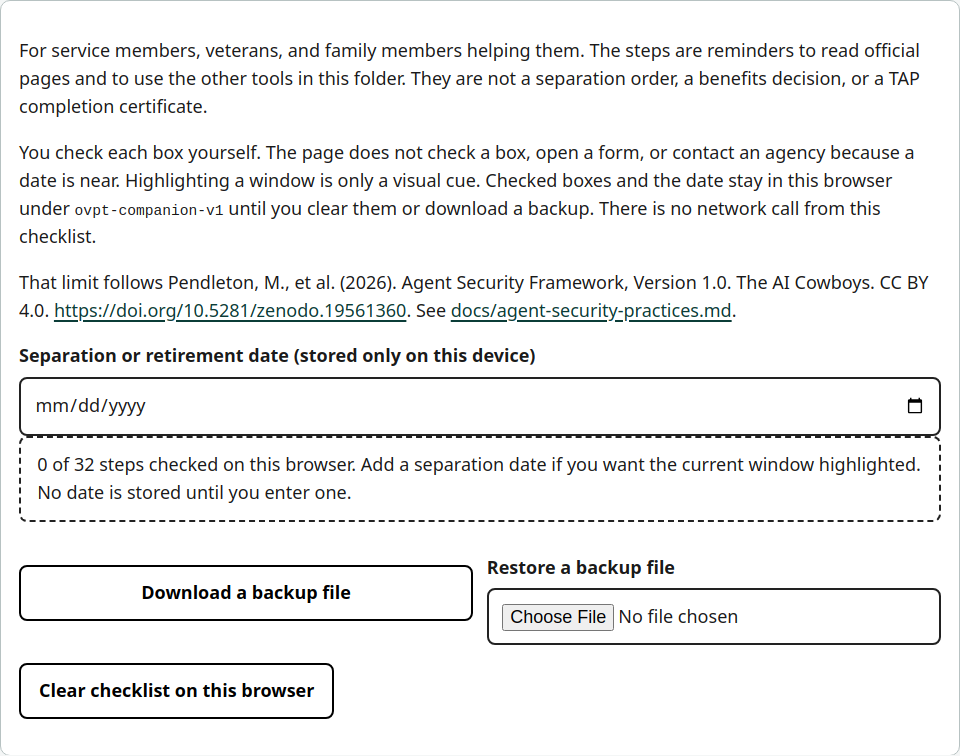

# Open Veteran Pathways Toolkit

**Built by The AI Cowboys**

The Open Veteran Pathways Toolkit is a free, open-source set of tools from The AI Cowboys Foundation. It helps veterans, military families, and older adults translate military experience into civilian career language, learn plain-English habits for using AI, and follow a separation checklist that points to official public pages on education and benefits. The pages are static files. After they load, lookups, quizzes, and checklists run in the browser. There is no account, no analytics, and no call that sends what you type to a server. After one online visit, the same files can open again with the network off.

The AI Cowboys Foundation, [www.theaicowboysfoundation.org](https://www.theaicowboysfoundation.org), a veteran-owned AI lab in San Antonio. The Foundation is a Texas 501(c)(3).

The Foundation is not part of the Department of Defense or the Department of Veterans Affairs. Nothing here is legal, medical, financial, benefits, or employment advice.

Open the toolkit on the Foundation site at [www.theaicowboysfoundation.org/learn/open-veteran-pathways](https://www.theaicowboysfoundation.org/learn/open-veteran-pathways), or on GitHub Pages at [the-ai-cowboys-projects.github.io/open-veteran-pathways-toolkit](https://the-ai-cowboys-projects.github.io/open-veteran-pathways-toolkit/). The source code is at [github.com/The-AI-Cowboys-Projects/open-veteran-pathways-toolkit](https://github.com/The-AI-Cowboys-Projects/open-veteran-pathways-toolkit).

This repository is public so it can be reviewed. It does not report a grant award, a user count, or a partnership that is not in the git history.

## Grant status

Submitted to the Sentient Foundation Open Source AGI Grant (Grant track) on November 13, 2026 at 9:14 PM CT.

## Tools

These four tools are everything in this repository. Each live link below is the tool page itself.

| Tool | What it does | Live pages |
| --- | --- | --- |
| Career Pathway Translator | Search an Army, Navy, Air Force, Marine Corps, Coast Guard, or Space Force code or title and read the DMDC crosswalk, O*NET 31.0 title, description, skills, and sample civilian titles stored with the page. A separate box rewords pasted bullets with the military-to-civilian phrase dictionary, and nothing you type is uploaded. | [Foundation site](https://www.theaicowboysfoundation.org/learn/open-veteran-pathways/career-pathway-translator/index.html) · [GitHub Pages](https://the-ai-cowboys-projects.github.io/open-veteran-pathways-toolkit/career-pathway-translator/index.html) · [In this repo](career-pathway-translator/index.html) |
| Scam Guardian | Paste a message, or read a screenshot with local OCR, and see which written scam rules matched. A point rubric is a second reading, an optional on-device model can be downloaded later, and the page does not detect deepfakes. | [Foundation site](https://www.theaicowboysfoundation.org/learn/open-veteran-pathways/scam-guardian/index.html) · [GitHub Pages](https://the-ai-cowboys-projects.github.io/open-veteran-pathways-toolkit/scam-guardian/index.html) · [In this repo](scam-guardian/index.html) |
| Plain-English AI Tutor | Twelve original lessons, 95 glossary entries, and 64 quiz questions explain how to use AI carefully, and each factual claim links a public source. A question box shows matching passages from those lessons, and an optional on-device model can phrase an answer only from those passages. | [Foundation site](https://www.theaicowboysfoundation.org/learn/open-veteran-pathways/ai-tutor/index.html) · [GitHub Pages](https://the-ai-cowboys-projects.github.io/open-veteran-pathways-toolkit/ai-tutor/index.html) · [In this repo](ai-tutor/index.html) |
| Transition Companion | A 32-step checklist runs from 24 months before separation through the first civilian year and links the other tools plus official public pages on careers, education, and benefits. An optional date highlights the closest window, and checked boxes stay in this browser. | [Foundation site](https://www.theaicowboysfoundation.org/learn/open-veteran-pathways/transition-companion/index.html) · [GitHub Pages](https://the-ai-cowboys-projects.github.io/open-veteran-pathways-toolkit/transition-companion/index.html) · [In this repo](transition-companion/index.html) |

The career file holds 26,883 military rows (13,513 active), 1,016 occupations, and 8,361 phrase-dictionary rows. Scam Guardian ships 14 rules plus a 10 KiB SMS model. Its OCR runtime is about 14.2 MiB. The optional model is not in the repository. The tutor text and the checklist are in the pages. Companion checks live in `localStorage`.

Each folder has its own `index.html` and can be copied into a site’s public directory. Paths between tools, styles, the manifest, and the service worker are relative, so the same files work on GitHub Pages and under a subpath such as `/learn/open-veteran-pathways/`. Keep the four folders and the repository root side by side if you want the installable offline copy. A single tool folder still runs its own page. The install button and the shared offline cache live with the full set of files.

## Run them

From the repository root:

```bash
python3 -m http.server 8765
```

Or `python3 scripts/serve.py`, which is the same kind of static server with threads so the offline cache can fetch many files at once.

Open `http://127.0.0.1:8765/`.

Pasted text, quizzes, and the checklist also work if you open the HTML file directly. Screenshot OCR, installation, and the offline cache do not. Browsers block the OCR worker from `file://`, and a service worker needs HTTP. Use the local server, GitHub Pages, or any other static host. The host does not receive what you type or the image. Tesseract runs in the page.

Check the logic without a browser, then the pages:

```bash
node scripts/verify.mjs
npm ci
npx playwright install chromium
npm test
```

Rebuild career data or the SMS model only if you intend to refresh upstream files. The scripts download public files and write the JavaScript the pages already include:

```bash
python3 scripts/build_career_data.py
python3 scripts/build_scam_model.py
bash scripts/vendor_tesseract.sh
```

## Screenshots

Free-text translation uses the dictionary stored with the page. The MOS to CEO Translator link leaves this repository.



The optional model states its size and the Gemma terms before any download. The rules still run when it is absent.



A tutor question shows passages from the lessons, with the source link, before any model wording.



The companion tells the person that checking a box is their action.



## Honest limits

- A crosswalk match is not a job offer, a license, or a VA decision. Infantry and some other codes point at military O*NET occupations (group 55). The page labels those.
- Civilian titles in the phrase dictionary are wording suggestions. Four O*NET codes in those notes are older than the 31.0 file used here.
- Skill identifiers, prefixes, and Navy additional qualification designators are not in the career file.
- Scam Guardian is an aid. A low score is not a clearance. It does not judge pictures of faces, voices, or video.
- OCR misreads blurry screenshots. Correct the text before you rely on it.
- Checklist progress and tutor progress are only as durable as the browser. Export the JSON backup from the companion or the tutor if you need a copy.
- The offline cache stores the public files after the first visit. It does not store a classified network, and it does not make a shared computer private.
- Scam Guardian does not detect deepfakes. The tutor’s synthetic-media lesson says so, and it does not explain how to make one.
- The optional Gemma model was not scored on veteran-benefits messages in this repository. A label it returns is not a measured probability. The written rules do not change because of it. The rule engine, the point rubric, and the small SMS model were scored on 22 synthetic messages. The numbers and the limits are in [docs/EVALUATION.md](docs/EVALUATION.md).
- The phrase dictionary shipped here is 8,361 rows. It is not the military crosswalk.

## Install and offline use

`manifest.webmanifest` and `sw.js` sit at the repository root. `start_url` and `scope` are `./`, resolved from wherever the files are served, including a project-site subpath and a folder such as `/learn/open-veteran-pathways/`. Icons are flat brand-color bars in teal `#3DD8C8` and magenta `#DD378A` on black. They are not a logo. Buttons use interface magenta `#D4348A` so black text on the button and the color on white both clear WCAG 2.1 AA for normal text. See [docs/ACCESSIBILITY.md](docs/ACCESSIBILITY.md).

The service worker precaches each tool’s HTML, CSS, and scripts, the DMDC and O*NET files (`moc.js` and `occupations.js`), the naive Bayes model, and the Tesseract.js worker, LSTM cores, and English traineddata. The cache name is versioned. When a new version is installed, older caches are deleted. If a page is already open, it shows **Load the update** instead of swapping the running page by itself.

Chrome and Edge can show an **Install** button when the site is served over HTTPS or localhost. iPhone and iPad use Safari’s Share menu, then Add to Home Screen. The instructions are on every page. After one online visit, the tools open again with the network off.

## GitHub Pages

`.github/workflows/pages.yml` checks `node scripts/verify.mjs`, then publishes the repository root with GitHub Actions. The public site is [https://the-ai-cowboys-projects.github.io/open-veteran-pathways-toolkit/](https://the-ai-cowboys-projects.github.io/open-veteran-pathways-toolkit/). `.nojekyll` is present so Pages serves the files as they are.

## Download a copy

`python3 scripts/package_offline_zip.py` writes `dist/open-veteran-pathways-toolkit-offline.zip`. Unpack it and serve the folder with any static server. Opening the HTML files directly still runs pasted text, quizzes, and the checklist. OCR, installation, and the service worker need HTTP. The optional model weights are not in the zip. The browser runtime that can load them is. `THIRD_PARTY_LICENSES.md` is in the zip.

`.github/workflows/release-zip.yml` builds that zip on demand and attaches it to a GitHub release when a tag named `v*` is pushed.

## Accessibility

The target is WCAG 2.1 Level AA for the landing page and the four tools. [docs/ACCESSIBILITY.md](docs/ACCESSIBILITY.md) lists the contrast figures, the axe-core checks, and the screen-reader pass that has not been done.

## Evaluation

`npm run eval:scam` scores Scam Guardian on 22 synthetic messages. [docs/EVALUATION.md](docs/EVALUATION.md) has the numbers from that script, including the misses. The optional on-device model was not scored.

## Pilot plan

[docs/PILOT_PLAN.md](docs/PILOT_PLAN.md) is a plan for a later usability session with veterans, recruited through veteran service organizations and university veteran centers. It is not a report of a session, a partner, or a user count.

## Security posture

There is no account and no analytics. Typed text stays in the browser unless the person chooses the optional model download. Actions are pinned to commit SHAs. Workflow permissions start at `contents: read`. `npm audit` is expected to report 0 known vulnerabilities. Report a problem as [SECURITY.md](SECURITY.md) describes, to contact_us@theaicowboys.com, and do not include personal information. Each tool page has a Send feedback link to that address with the same reminder.

## Docs

The notes in [docs/README.md](docs/README.md) index the research record, the agent-security note, the accessibility statement, the evaluation, and the pilot plan.

## License

MIT for the Foundation’s code and original writing. See [LICENSE](LICENSE).

Third-party license notices: see THIRD_PARTY_LICENSES.md.
